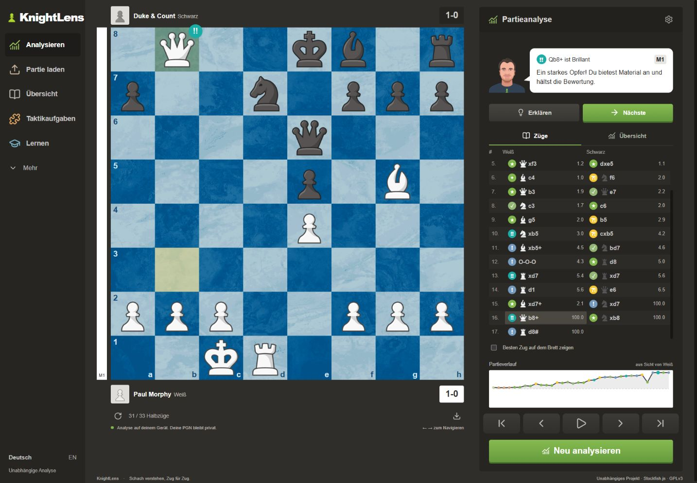
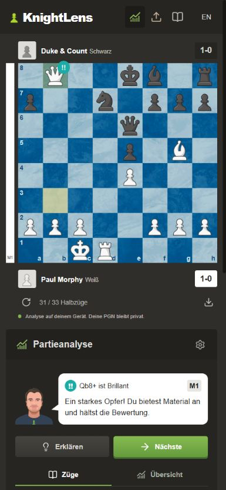

<div align="center">
  

  # KnightLens

  **Chess, understood. Review your games with Stockfish 18 and a coach that explains each move.**

  [](https://pxnami.github.io/KnightLens/)
  [](https://github.com/pxnami/KnightLens)
  [](https://github.com/pxnami/KnightLens/issues)

  <sub>English & Deutsch · Local engine · No account or subscription</sub>
</div>

<br>



## What it does

Import a PGN or find your recent public games on Chess.com and Lichess. KnightLens evaluates every position in your browser, marks important moves, and explains the position in German or English.

| Import | Understand | Explore |
| --- | --- | --- |
| Paste PGN or open a PGN file | Ten move categories, from Brilliant to Blunder | Replay with buttons or arrow keys |
| Browse up to 20 recent public games | Accuracy estimates for both players | Flip the board and show the best move |
| Select games from multi-game PGN files | Position-based coach and engine continuations | Try legal moves and return to the game |
| Chess.com and Lichess profiles | Clickable evaluation graph and category counts | Export the imported PGN |

The interface follows the requested Chess.com review layout with Neo pieces, the Icy Sea board and a coach speech bubble. Artwork loads directly from official Chess.com image hosts and needs a network connection.

## Interface

<table><tr><td width="72%"></td><td width="28%"></td></tr></table>

## Analysis

Stockfish.js **18.0.8**, implementing **Stockfish 18**, runs in a Web Worker. The default single-threaded Lite engine downloads about 7 MB. Enable **Full NNUE** before starting analysis to use the full engine, which downloads about 113 MB. Both builds work on GitHub Pages without cross-origin isolation headers. Search depth is selectable: 12, 14, 18, or 22.

Chess.com identifies Stockfish 18 as its current engine in its [engine documentation](https://support.chess.com/en/articles/9462780-how-do-the-chess-engines-on-chess-com-work). Sharing the engine version does not make the results identical: hardware, search depth, engine build and classification methods matter.

Move categories and accuracy are **independent estimates**, not Chess.com scores. Classification uses evaluation loss, a logistic winning-chance estimate, the engine's preferred move and second candidate, a conservative sacrifice heuristic, and a small bundled opening repertoire. Brilliant detects a preferred move offering a higher-value piece for capture while preserving the evaluation; it does not prove a forced sacrifice. Book only recognizes bundled opening prefixes. Accuracy averages a bounded exponential transformation of winning-chance loss. Coach explanations are deterministic and based on actual moves, engine lines and board features; no external AI service is used.

Public profile requests go directly to the respective platform. Chess.com searches the three latest available archive months, stopping after enough games are found. Lichess exports the latest 20 finished standard games. Rate limits, upstream availability and browser network restrictions can affect imports; PGN import works independently. PGN analysis stays on-device. Only the selected interface language is stored locally.

## Run locally

Requires Node.js 22 or newer.

```sh
git clone https://github.com/pxnami/KnightLens.git
cd KnightLens
npm ci
npm run dev
```

Open the URL printed by Vite, normally `http://localhost:5173/KnightLens/`.

```sh
npm test             # PGN parsing, rules, grading and coaching tests
npm run typecheck    # TypeScript
npm run build        # Prepare engine assets and build dist/
npm run preview      # Preview production build
```

## Built with

| Area | Technology |
| --- | --- |
| Interface | React, TypeScript, Lucide, Chess.com-style review layout |
| Chess rules and PGN | chess.js |
| Evaluation | Stockfish.js 18, WebAssembly, Web Workers |
| Build and checks | Vite, TypeScript, Vitest |
| Delivery | GitHub Actions and GitHub Pages |

## Deployment

The [Pages workflow](.github/workflows/pages.yml) installs dependencies, runs tests, builds the app and deploys `dist/` on pushes to `main`. The engine binaries are copied from the pinned npm dependency during the build and are excluded from Git. No environment variables or secrets are needed.

## License and attribution

KnightLens source is licensed under [GPL-3.0-or-later](LICENSE). Stockfish.js is GPLv3; its pinned source and build instructions are available in [nmrugg/stockfish.js at v18.0.8](https://github.com/nmrugg/stockfish.js/tree/v18.0.8). Engine files are distributed unmodified. See [THIRD_PARTY.md](THIRD_PARTY.md) for asset and dependency credits.

Independent project, not affiliated with Chess.com or Lichess.
